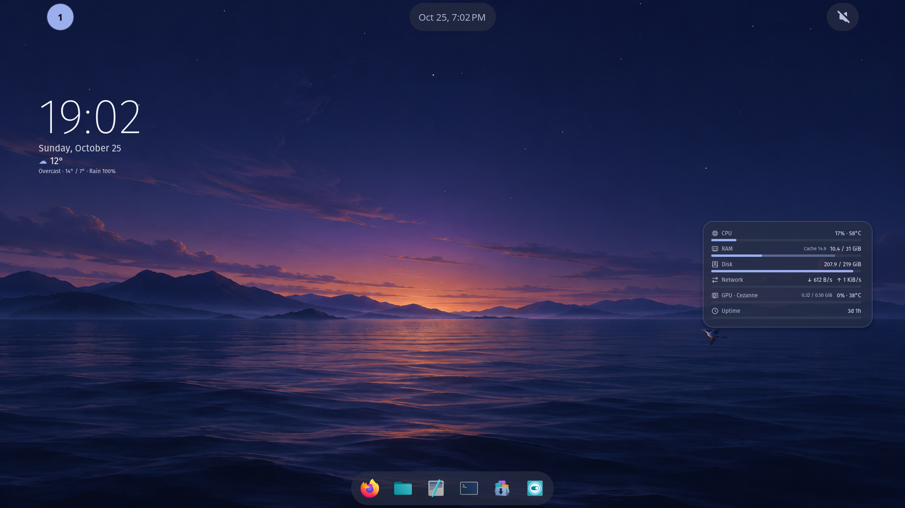
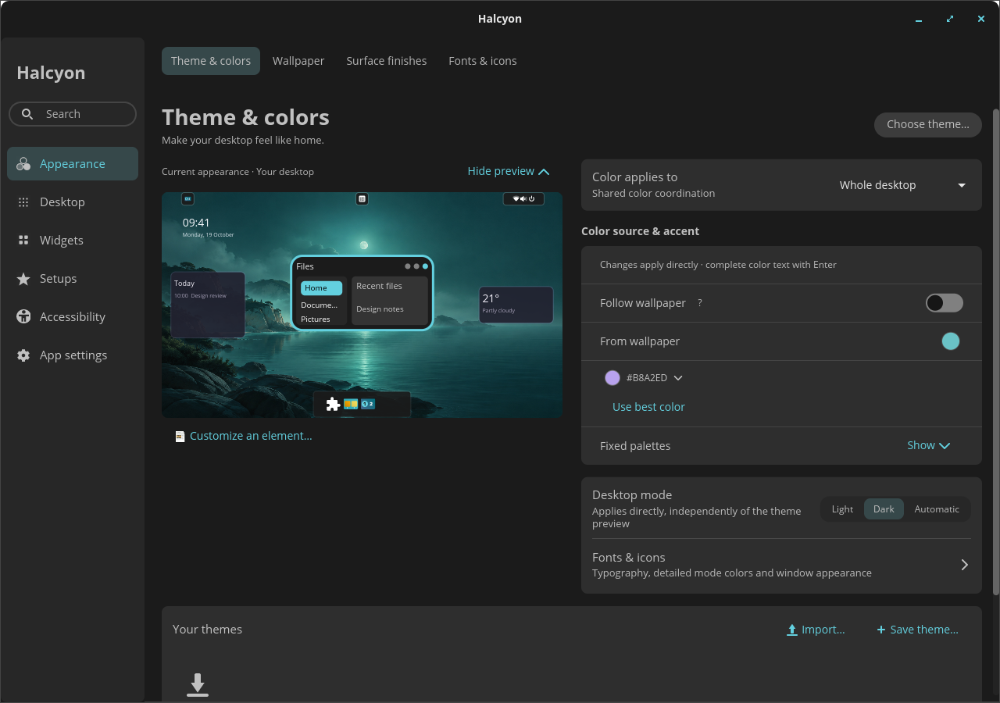

# Halcyon

Desktop widgets, themes and layouts for **COSMIC on Pop!_OS 24.04**.

**[Download 0.3.0](https://github.com/profilaz3/halcyon/releases/download/v0.3.0/cosmic-ext-halcyon_0.3.0_amd64.deb)** · [Release notes](https://github.com/profilaz3/halcyon/releases/tag/v0.3.0) · [Report an issue](https://github.com/profilaz3/halcyon/issues)

[](docs/screenshots/030/everyday-islands.png)

- **Widgets:** clock, weather, calendar, system monitor, music, Git projects, notes and focus timer.
- **Layout:** move, resize and order widgets; assign each to a display.
- **Appearance:** wallpapers, light and dark themes, colors, fonts and surface finishes.
- **Setups:** six starter configurations, saved layouts and scheduled switching.

## Install

Download the `.deb` above, then run:

```sh
sudo apt install ./cosmic-ext-halcyon_0.3.0_amd64.deb
```

For 64-bit Intel and AMD PCs. Open **Halcyon** from the application launcher; setup lets you choose a look, enable widgets and arrange them.

Fresh installations enable the signed APT source by default. Future updates use APT or **COSMIC Store → Updates**. Existing disabled or modified sources are preserved. [Update and removal instructions](docs/DISTRIBUTION.md).

## Settings

Settings and first-run setup now use GPU rendering. The native interface groups appearance, desktop controls, widgets, Setups, accessibility and app settings. Desktop previews show your changes; Recent changes provides eligible Undo actions.

[](docs/screenshots/030/settings-wide.png)

[Native capture details and more screenshots](docs/screenshots/030/README.md) · [Rendering measurements](docs/PERFORMANCE.md)

## Optional Islands

Islands splits the dock and panel into floating applet groups. It also provides bar surface finishes. Install the [matching add-on](https://github.com/profilaz3/halcyon/releases/download/v0.3.0/cosmic-ext-halcyon-islands_0.3.0_amd64.deb):

```sh
sudo apt install ./cosmic-ext-halcyon-islands_0.3.0_amd64.deb
halcyon-islands enable
```

Log out and back in. Widgets and themes work without Islands. [Compatibility, activation and removal](packaging/islands/README.md).

## Calendar and privacy

Calendar supports read-only HTTPS/iCal subscriptions. Google Calendar requires your own OAuth client configuration; live Google sign-in validation is pending.

Usage sharing is enabled by default. Turn it off during setup or in **App settings → Privacy**. Reports include a random installation ID, app version, approximate country and first desktop start; they exclude widget content. [Privacy details](docs/PRIVACY.md).

## Development

Built with Rust and libcosmic. [Build and contribute](docs/DEVELOPMENT.md) · [Package details](packaging/README.md) · [GPL-3.0-or-later](LICENSE) · [Third-party notices](THIRD_PARTY.md).
