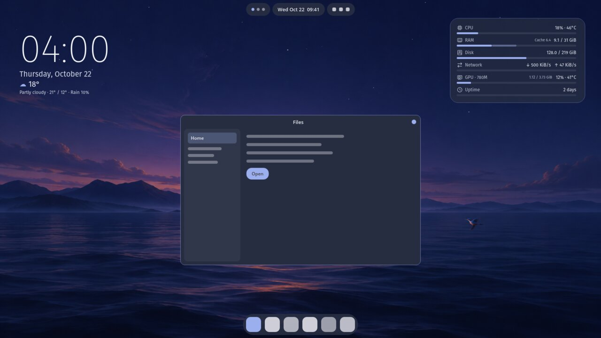
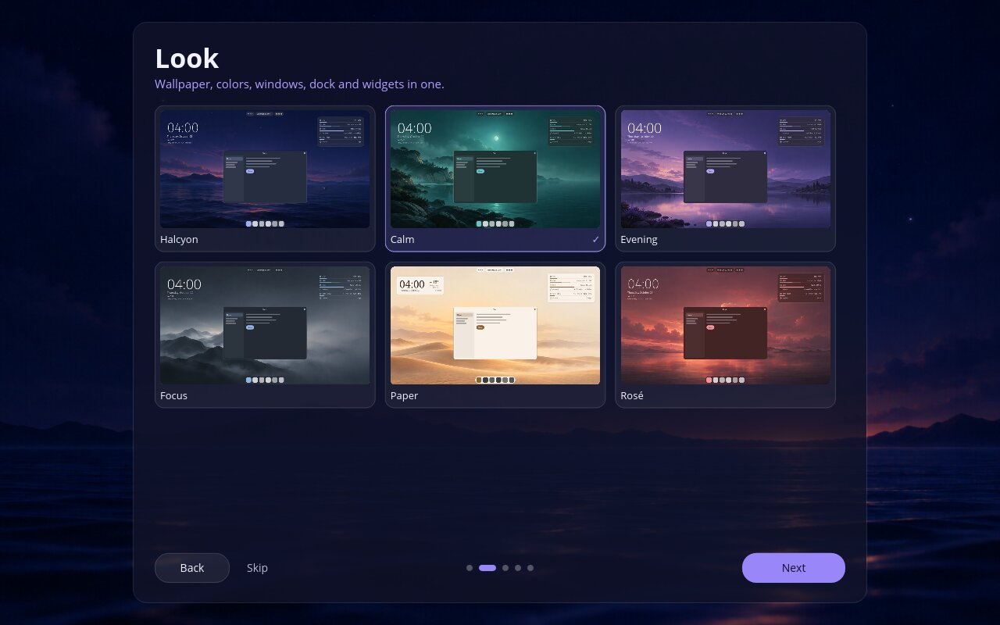

# Halcyon

Desktop widgets and themes for COSMIC.

Halcyon puts a small set of widgets on your COSMIC desktop and gives the whole
desktop a coordinated look: wallpaper, colors, windows, dock and panel.

- **Starter looks.** Six complete looks, each with its own wallpaper. Colors
  follow the wallpaper.
- **Widgets.** At a glance (clock, date, weather), system monitor, calendar,
  projects, music, notes and a focus timer. Widgets never overlap; music shows
  while something is playing or paused.
- **Styles.** Thirteen widget styles, from soft cards and frosted glass to
  outlines, paper and terminal, with matching dock and panel.
- **Gentle on your setup.** A look changes what it owns (wallpaper, colors,
  dock and panel appearance, the widgets it places). Your applets, their
  order, your panel position and the widgets you set up stay yours. Every
  change can be undone.

| First run | Choosing a look |
|---|---|
|  |  |

## Install

- **Pop!_OS 24.04 (COSMIC):** download `cosmic-ext-halcyon_<version>_amd64.deb`
  from the [Releases page](https://github.com/profilaz3/halcyon/releases),
  open it, and choose Install. Or, in a terminal:
  `sudo apt install ./cosmic-ext-halcyon_<version>_amd64.deb`
- **From source:** build with `cargo build --release --locked`, then run
  `python3 scripts/install.py` to install for your account under `~/.local`.
  Details in [docs/DEVELOPMENT.md](docs/DEVELOPMENT.md).

To update this first release, download and install the newer `.deb` from
GitHub Releases. A system update repository is planned but is not yet active.
See [distribution and updates](docs/DISTRIBUTION.md) for the rollout plan.

Upgrading from Desktop Cards (the earlier name) keeps your settings, notes,
looks and calendar connection.

To remove Halcyon: `sudo apt remove cosmic-ext-halcyon`. Your settings and
notes stay in `~/.config/halcyon` and `~/.local/share/halcyon` until you delete
them. Desktop changes made by a look (wallpaper, colors, dock and panel) stay
too; undo them in Halcyon's Setups page before removing it if you like.

After installing, open **Halcyon** from the app launcher. A short setup picks a
look, your dock and panel, and your city for the weather.

**Islands** (a panel split into floating islands) is an optional, separate
add-on, `cosmic-ext-halcyon-islands`. It only runs on the exact COSMIC versions
it was tested with and otherwise leaves the normal panel in place. See
[packaging/islands/README.md](packaging/islands/README.md).

## What leaves your computer

- **Weather:** your city search text and the chosen city's coordinates go to
  [Open-Meteo](https://open-meteo.com).
- **Calendar (optional):** if you connect Google Calendar, Halcyon talks to
  Google with your permission. Sign-in tokens stay in your system keyring.
- **Album art:** artwork your music player names is downloaded from its
  public HTTPS address.

No analytics, no tracking, no account needed.

## License

GPL-3.0-or-later. See [LICENSE](LICENSE), [ASSETS.md](ASSETS.md) for the
artwork and [THIRD_PARTY.md](THIRD_PARTY.md) for dependencies.
