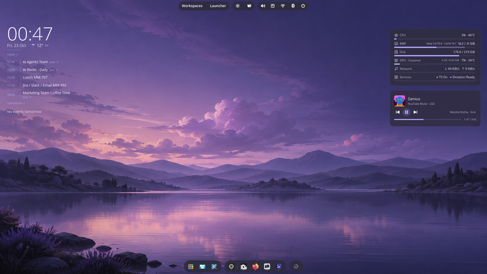
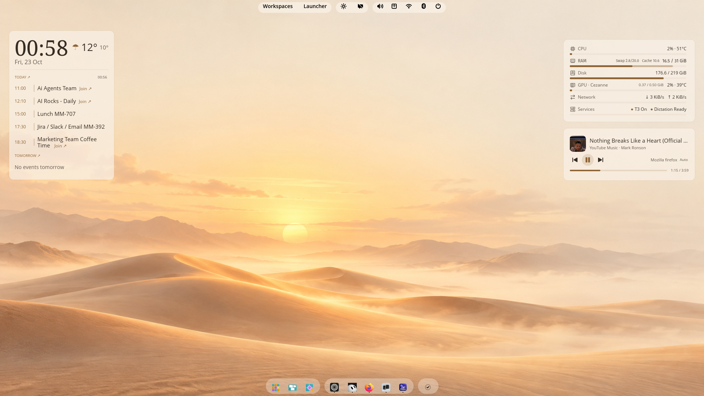
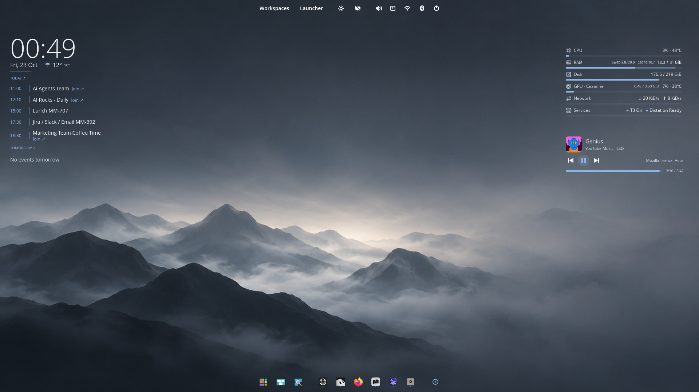
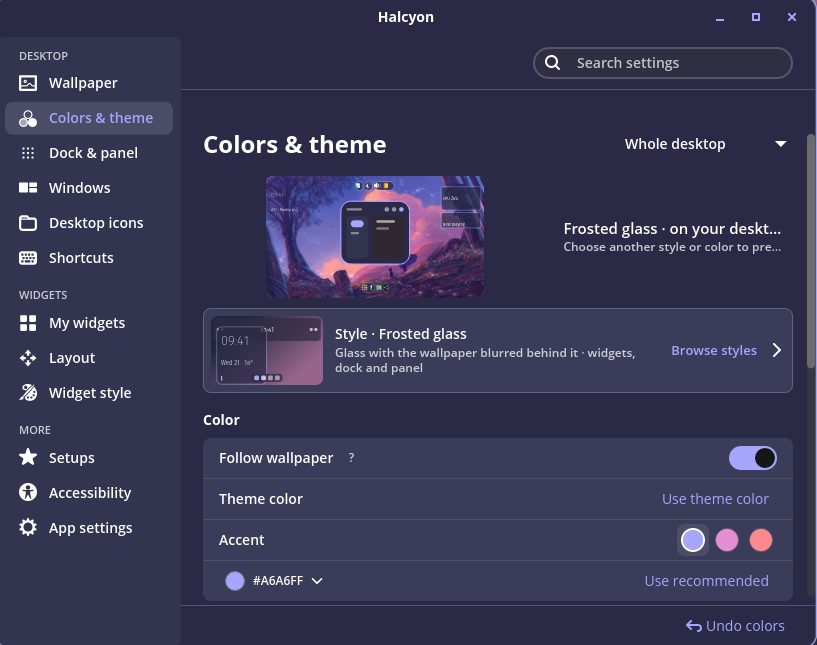
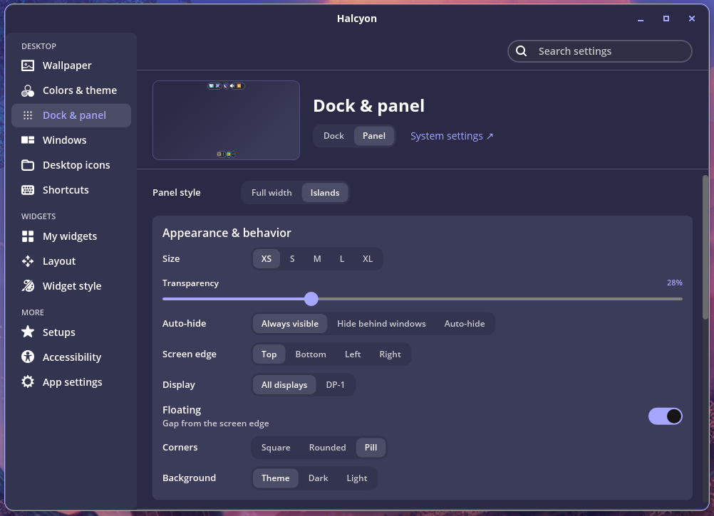

<p align="center">
  
</p>

<h1 align="center">Halcyon</h1>

<p align="center">Desktop widgets and themes for COSMIC.</p>

<p align="center">
  <a href="https://github.com/profilaz3/halcyon/releases/latest"><strong>Download</strong></a> ·
  <a href="#install">Install</a> ·
  <a href="docs/DEVELOPMENT.md">Build from source</a> ·
  <a href="https://github.com/profilaz3/halcyon/issues">Issues & feature requests</a>
</p>

[](docs/screenshots/desktop-purple.png)

Change the wallpaper, follow its colors across widgets and COSMIC, and arrange
what you want to see on your desktop.

**Pop!_OS 24.04 · Intel & AMD 64-bit · Rust + libcosmic · Free and open source**

## Different looks, same desktop

Six starter looks and thirteen widget styles. Use light cards, frosted surfaces,
outlines or transparent text. Adjust colors, fonts and corners to suit your wallpaper.

<table>
  <tr>
    <td width="50%"><a href="docs/screenshots/desktop-paper.png"></a></td>
    <td width="50%"><a href="docs/screenshots/desktop-mist.png"></a></td>
  </tr>
  <tr>
    <td><strong>Light</strong><br>Solid cards and a warm palette.</td>
    <td><strong>Transparent</strong><br>Clock, agenda and metrics directly on the wallpaper.</td>
  </tr>
</table>

*Real desktop screenshots. Click an image to open it at full size.*

## Widgets

Clock, weather, calendar, system monitor, music, Git projects, notes, checklists
and a focus timer. Keep them separate or combine clock, weather and calendar
in one overview.

- **Arrange:** drag, resize and snap widgets in the layout editor or on the desktop.
- **System monitor:** choose and reorder metrics, with optional history graphs.
- **Music:** playback and seeking through MPRIS; controls depend on the player.
- **Setups:** save your layout and appearance to return to later.

The screenshots show an existing Calendar connection. Google Calendar sign-in
is not configured in the public **0.1.1** package; the other widgets work without it.

## Wallpaper & colors

Turn on **Follow wallpaper** to update colors when the wallpaper changes.
Apply them to widgets and COSMIC, or just the widgets. Pick another extracted
color or set your own. Appearance changes apply immediately, with Undo.

<p align="center">
  <a href="docs/screenshots/settings-colors.png"></a>
</p>

## Dock, panel & Islands

Set the dock and panel's placement, size, transparency and corners.
**Islands** groups applets into separate floating sections, as shown in the
desktop screenshots above.

<p align="center">
  <a href="docs/screenshots/settings-panel.png"></a>
</p>

Islands needs a **separate, version-matched package**. For widgets and themes,
install only Halcyon. [Islands compatibility and installation →](packaging/islands/README.md)

## Install

**Packaged for Pop!_OS 24.04 with COSMIC, on 64-bit Intel and AMD PCs.**
The `amd64` package is for x86-64 processors from either manufacturer; it is
not AMD-only. ARM devices need a separate build.
This is an early release; please report problems with your Halcyon and COSMIC
versions.

1. Download the main `cosmic-ext-halcyon_<version>_amd64.deb` from
   [GitHub Releases](https://github.com/profilaz3/halcyon/releases/latest).
2. Install the downloaded file. For v0.1.1:

   ```sh
   sudo apt install ./cosmic-ext-halcyon_0.1.1_amd64.deb
   ```

3. Open **Halcyon** from the app launcher. The first-run setup helps you choose
   a look, dock and panel arrangement, and weather city.

Installing the package alone does not change your desktop or start the widgets.

**Calendar:** Google Calendar sign-in requires publisher OAuth setup.
Check the release notes for whether it is configured in your download.
The other widgets do not require a Google account.

**Updates:** download a newer `.deb` and install it the same way. Your settings
are preserved. There is no automatic update feed or Flatpak release yet.
[Distribution plan](docs/DISTRIBUTION.md)

<details>
<summary>Upgrading from Desktop Cards or uninstalling</summary>

Halcyon was previously called Desktop Cards. On first start, it copies your
existing settings, notes, looks and calendar connection to the new locations
and keeps the old folders.

Remove the package with:

```sh
sudo apt remove cosmic-ext-halcyon
```

Your settings and notes stay in `~/.config/halcyon` and
`~/.local/share/halcyon`. Wallpaper, colors, dock and panel changes stay too;
restore the desktop changes you want to reverse in Halcyon before removing it.
If you installed Islands, follow its
[separate removal instructions](packaging/islands/README.md).

</details>

## Under the hood

Halcyon is a native **Rust + libcosmic** application. Its Wayland desktop
surfaces sit above the wallpaper and below application windows. It integrates
with COSMIC's settings, uses **MPRIS over D-Bus** for music, and uses a
**systemd user service** for the widgets. Python helpers handle calendar
synchronization and project scanning.

| For | Start here |
| --- | --- |
| Building and contributing | [Developer reference](docs/DEVELOPMENT.md) |
| Package layout and per-user data | [Packaging](packaging/README.md) |
| Native panel companion | [Islands](packaging/islands/README.md) |
| Performance and refresh behavior | [Performance](docs/PERFORMANCE.md) |
| Release and update channels | [Distribution](docs/DISTRIBUTION.md) |

Found a bug? [Open an issue](https://github.com/profilaz3/halcyon/issues) with
steps to reproduce, your app and COSMIC versions, and a screenshot if useful.
Code, documentation and design contributions are welcome.

## Privacy

No analytics or tracking. Weather queries and selected coordinates go to
[Open-Meteo](https://open-meteo.com). Connecting Google Calendar allows Halcyon
to fetch your calendar; sign-in tokens stay in your system keyring. Music
artwork may be fetched from the public HTTPS URL supplied by your player.

## License

[GPL-3.0-or-later](LICENSE).
[Artwork provenance](ASSETS.md) · [Third-party notices](THIRD_PARTY.md)

Halcyon is an independent project for COSMIC, not an official System76 product.
