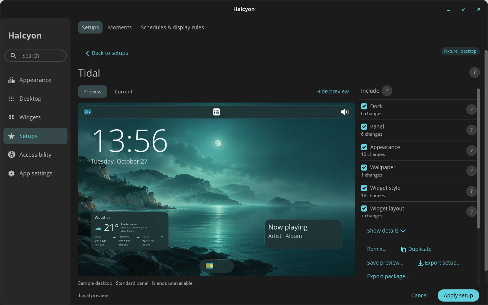
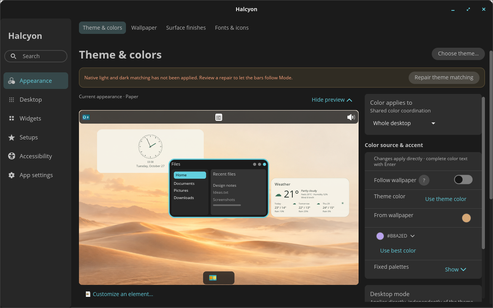

# Halcyon

Desktop widgets, themes and layouts for **COSMIC on Pop!_OS 24.04**.

**[Download 0.4.0](https://github.com/profilaz3/halcyon/releases/download/v0.4.0/cosmic-ext-halcyon_0.4.0_amd64.deb)** · [Release notes](https://github.com/profilaz3/halcyon/releases/tag/v0.4.0) · [Report an issue](https://github.com/profilaz3/halcyon/issues)

[](docs/screenshots/040/setup-preview.png)

- **Widgets:** clock, weather, calendar, system monitor, music, Git projects, notes and focus timer.
- **Layout:** move, resize and order widgets in Canvas; assign each to a display.
- **Appearance:** wallpapers, light and dark themes, colors, fonts and surface finishes.
- **Setups:** starter compositions, wallpaper/style/layout remixing, shared setup packages and scheduled switching.

## Install

1. Download **Halcyon** using the button above. Choose the main app; Islands is optional.
2. Open the downloaded file with **COSMIC Store**, choose **Install**, and approve the system password prompt if asked.
3. Open **Halcyon** from the application launcher and finish setup.

For 64-bit Intel and AMD PCs running Pop!_OS 24.04 with COSMIC. Stay online so the system can fetch any missing dependencies. If the Store cannot install the local file, use:

```sh
sudo apt install ~/Downloads/cosmic-ext-halcyon_0.4.0_amd64.deb
```

Setup lets you choose a look, enable widgets and arrange them. Adjust the fallback command if you saved the file elsewhere.

Fresh installations enable the signed APT source by default. Future updates use APT or **COSMIC Store → Updates**, according to your OS update settings. This does not turn on automatic installation. Existing disabled or modified sources are preserved. [Update and removal instructions](docs/DISTRIBUTION.md).

## Settings

Settings and first-run setup use GPU rendering. Controls reflow into columns, with help beside settings that need explanation. Desktop previews show changes before Apply; Recent changes provides eligible Undo actions.

[](docs/screenshots/040/settings-wide.png)

[Native capture details and more screenshots](docs/screenshots/040/README.md) · [Rendering measurements](docs/PERFORMANCE.md)

## Optional Islands

Islands splits the dock and panel into floating applet groups and adds bar surface finishes.

Open **App settings → Updates → Get Islands…**. Review the installation, approve the system installer, then choose **Enable for next login**. Log out and back in.

Widgets and themes work without Islands. [Compatibility, manual installation and removal](packaging/islands/README.md).

## Calendar and privacy

Calendar supports read-only HTTPS/iCal subscriptions. Google Calendar requires your own OAuth client configuration; live Google sign-in validation is pending.

Usage sharing is enabled by default. Turn it off during setup or in **App settings → Privacy**. Reports include a random installation ID, app version, approximate country and first desktop start; they exclude widget content. [Privacy details](docs/PRIVACY.md).

## Development

Built with Rust and libcosmic. [Build and contribute](docs/DEVELOPMENT.md) · [Package details](packaging/README.md) · [GPL-3.0-or-later](LICENSE) · [Third-party notices](THIRD_PARTY.md).
