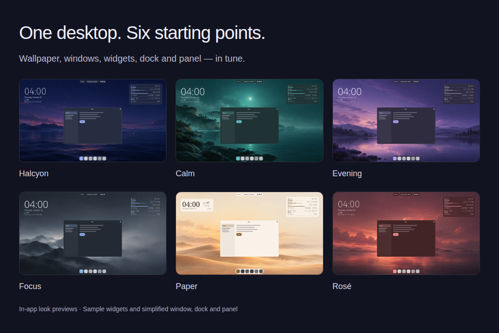
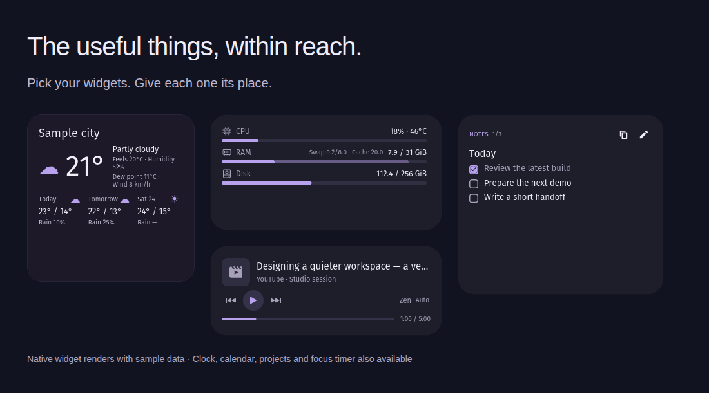
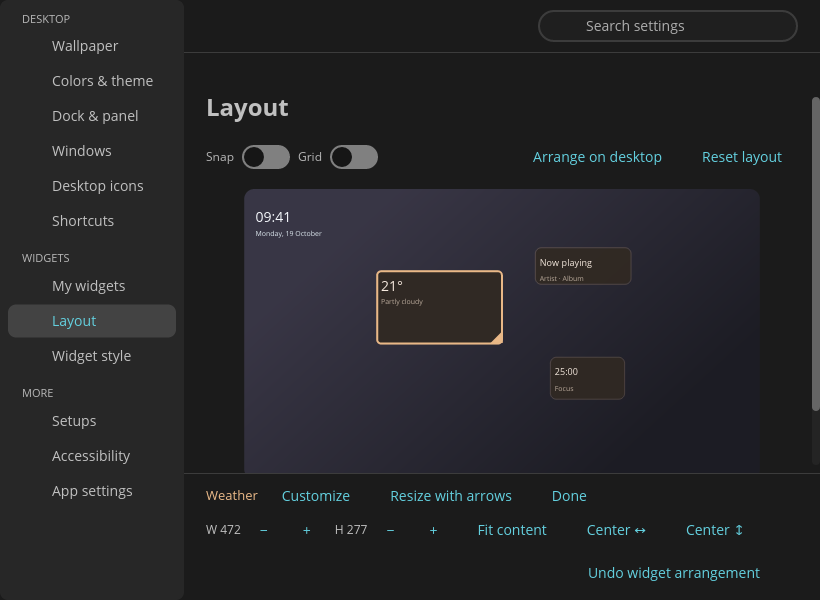

<p align="center">
  
</p>

<h1 align="center">Halcyon</h1>

<p align="center">
  Desktop widgets and themes for COSMIC.
</p>

<p align="center">
  <a href="https://github.com/profilaz3/halcyon/releases/latest"><strong>Download</strong></a> ·
  <a href="#install">Install</a> ·
  <a href="docs/DEVELOPMENT.md">Build from source</a> ·
  <a href="https://github.com/profilaz3/halcyon/issues">Report an issue</a>
</p>

Halcyon brings your wallpaper, colors, widgets, windows, dock and panel together.
Start with a complete look, then adjust the parts that matter to you. Keep the
weather nearby, see what your system is doing, control your music, or leave
yourself a note.

**Free and open source · Native Rust + libcosmic · No Halcyon account required**

## A desktop that belongs together

Choose one of six starter looks, or build your own. Let the accent follow your
wallpaper, choose another color from it, or set a color yourself. Thirteen widget
styles range from frosted cards to paper, outlines and plain text.



*Halcyon's built-in appearance previews. Window, dock and panel illustrations
are simplified; widget content uses sample data.*

## Useful at a glance

Show only what you need. Combine clock, weather and calendar in one overview,
or keep them separate.



- **Your day:** clock, local weather and an optional Google Calendar agenda.
- **Your system:** CPU, memory, disk, network and GPU readings, with optional
  history graphs and reorderable rows.
- **Your work:** Git project status, notes and checklists, and a focus timer.
- **Your music:** playback controls and seeking through your player's MPRIS
  interface. Available controls depend on the player.

## Put things where they work for you

Drag widgets around a preview of your desktop. Resize them, snap them to a
fine grid, or arrange them directly on the desktop. Save setups to return
to a layout you like.

<p align="center">
  
</p>

Appearance changes apply as you make them, with Undo. Choosing a shared style
keeps your applets and their order. Dock, panel, window and shortcut controls
stay available when you want to go further.

**Optional: Islands.** Split the native dock or panel into floating groups.
This uses a separate, version-matched companion package; it is not required
for Halcyon's widgets or themes.
[See compatibility and setup →](packaging/islands/README.md)

## Install

**Packaged for Pop!_OS 24.04 with COSMIC, on x86-64 (amd64).**
This is an early release; please report problems with your Halcyon and COSMIC
versions.

1. Download the main `cosmic-ext-halcyon_<version>_amd64.deb` from
   [GitHub Releases](https://github.com/profilaz3/halcyon/releases/latest).
2. Install the downloaded file. For v0.1.1:

   ```sh
   sudo apt install ./cosmic-ext-halcyon_0.1.1_amd64.deb
   ```

3. Open **Halcyon** from the app launcher. The first-run setup helps you choose
   a look, dock and panel arrangement, and weather city.

Installing the package alone does not change your desktop or start the widgets.

**Calendar:** Google Calendar sign-in requires publisher OAuth setup.
Check the release notes for whether it is configured in your download.
The other widgets do not require a Google account.

**Updates:** download a newer `.deb` and install it the same way. Your settings
are preserved. There is no automatic update feed or Flatpak release yet.
[Distribution plan](docs/DISTRIBUTION.md)

<details>
<summary>Upgrading from Desktop Cards or uninstalling</summary>

Halcyon was previously called Desktop Cards. On first start, it copies your
existing settings, notes, looks and calendar connection to the new locations
and keeps the old folders.

Remove the package with:

```sh
sudo apt remove cosmic-ext-halcyon
```

Your settings and notes stay in `~/.config/halcyon` and
`~/.local/share/halcyon`. Wallpaper, colors, dock and panel changes stay too;
restore the desktop changes you want to reverse in Halcyon before removing it.
If you installed Islands, follow its
[separate removal instructions](packaging/islands/README.md).

</details>

## Under the hood

Halcyon is a native **Rust + libcosmic** application. Its Wayland desktop
surfaces sit above the wallpaper and below application windows. It integrates
with COSMIC's settings, uses **MPRIS over D-Bus** for music, and uses a
**systemd user service** for the widgets. Python helpers handle calendar
synchronization and project scanning.

| For | Start here |
| --- | --- |
| Building and contributing | [Developer reference](docs/DEVELOPMENT.md) |
| Package layout and per-user data | [Packaging](packaging/README.md) |
| Native panel companion | [Islands](packaging/islands/README.md) |
| Performance and refresh behavior | [Performance](docs/PERFORMANCE.md) |
| Release and update channels | [Distribution](docs/DISTRIBUTION.md) |

Found a bug? [Open an issue](https://github.com/profilaz3/halcyon/issues) with
steps to reproduce, your app and COSMIC versions, and a screenshot if useful.
Code, documentation and design contributions are welcome.

## Privacy

No analytics or tracking. Weather queries and selected coordinates go to
[Open-Meteo](https://open-meteo.com). Connecting Google Calendar allows Halcyon
to fetch your calendar; sign-in tokens stay in your system keyring. Music
artwork may be fetched from the public HTTPS URL supplied by your player.

## License

[GPL-3.0-or-later](LICENSE).
[Artwork provenance](ASSETS.md) · [Third-party notices](THIRD_PARTY.md)

Halcyon is an independent project for COSMIC, not an official System76 product.
