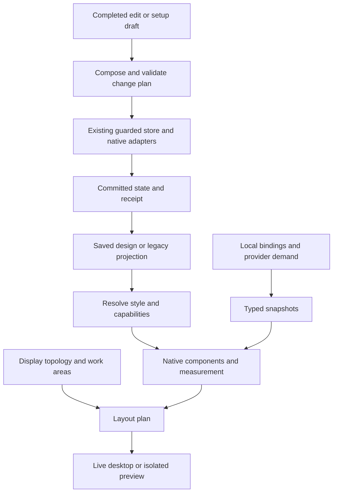

# Supporting architecture

Status: foundation contracts reviewed and FB05–FB19 locally implemented, 2026-10-27. Shared styling, Clock/Weather presentation and keyed Weather demand extend existing modules; layout, input and guarded edits use the existing owners. The complete local foundation is qualified in [FB09](FB09.md); FB10 adds real presets and bounded native font/gallery presentation; physical devices and packages remain later release gates. Names below describe contracts; they do not require new crates, daemons, IPC protocols or a general plugin framework. See [contracts](CONTRACTS.md), [capability results](CAPABILITIES.md), [budgets](BUDGETS.md), [FB06 acceptance](FB06.md) [FB07 acceptance](FB07.md) and [FB08 acceptance](FB08.md).

## Current foundations and constraints

| Responsibility | Existing implementation | Consequence |
| --- | --- | --- |
| Rendering | [Pinned native GPU renderer](../adr/0004-hardware-rendering.md), [widget views](../../src/app/settings_preview.rs) | Reuse libcosmic/Iced and real views; no web renderer or separate graphics engine |
| Styling | [Shared theme roles](../../src/desktop_theme.rs), [materials](../../src/materials.rs) | Extend semantic roles, font choices and inheritance rather than adding per-preset rendering branches |
| Placement | [Layout](../../src/layout.rs), [geometry snapshots](../../src/layout_state.rs), [display handling](../../src/app/monitors.rs) | Preserve logical geometry, measured natural sizes, display identity and recovery |
| Data | [Runtime](../../src/app.rs), [providers](../../src/data.rs), [tools](../../src/tools), [calendar](../../src/calendar) | Separate subscriptions from presentation incrementally; existing side effects remain owned by their services |
| Apply and recovery | [Profile planner](../../src/desktop/profiles/plan.rs), [store](../../src/desktop/store.rs), [native queue](../../src/settings/native_jobs.rs), [recovery](../desktop-recovery.md) | Keep one guarded commit path and existing lock order, journals, receipts and stale-work checks |
| Portable designs | [Profile format](../../src/desktop/profiles/format.rs) | Preserve bounded, allowlisted imports, local/portable distinctions and old-version readers |
| Scheduling | [Automation decisions](../../src/automation/decide.rs) | Extend event-based scheduling; do not continuously enforce a look over manual changes |

The runtime's [Widget enum](../../src/drawer.rs) has nine fixed kinds. Geometry validation expects exactly one entry per kind. Rendering surfaces, input routes and settings also use this identity. A custom-instance system must address all of these together; changing a gallery alone cannot provide duplicate widgets.

Settings samples already reuse real views, but some construct a large runtime `Cards` value. Extract the small presentation inputs those views need; do not instantiate providers or another runtime to render a preview.

## Six supporting systems

### 1 Design model and style resolver

**Input:** a saved design or a legacy-config projection, a selected moment, explicit overrides, accessibility preferences and observed capabilities.

**Output:** resolved presentation values with their origin, plus capability/fallback explanations. Resolution is deterministic, has no I/O and does not mutate preferences.

A design distinguishes `WidgetKind` (clock), `RecipeId` (a reusable presentation) and `InstanceId` (one placement). An instance references a recipe and carries layout/style overrides. Connection and content bindings are local, keyed by instance; a portable design declares the data it needs but contains no account IDs, note text or physical output IDs.

Shared tokens cover semantic ink/accent/surface colours, display/title/body/caption type roles, spacing, borders, corner shapes and motion. `Surface::None` is an explicit choice, not an opacity workaround. Materials remain independent of content and layout.

Reviewed value order, from lowest to highest: recipe defaults → setup style → active moment's shared style → instance overrides → explicit moment-instance overrides → local accessibility constraints. Capability adaptation then yields the supported representation. Constraints must hold after fallback as well. The inspector shows where a value came from; reset removes the selected layer's override and names the actual inherited source. No hidden inheritance chains or arbitrary style expressions. [Examples](examples/contracts.json) include explicit no-surface and moment-instance resets.

Moments are bounded override records, not copies of the entire desktop. They enter the schema only when their editing and manual-change rules pass review. Activity-driven Sessions remain deferred.

### 2 Component rendering and measurement

**Input:** resolved style, a typed data snapshot, content state, logical bounds and a render context.

**Output:** native widget elements, natural/minimum size, named actions and input/accessibility geometry. Clock faces and other variants share this contract.

Use the same component construction and measurement in desktop, editor and export previews. Text, lists and interactive controls retain native semantics; a blanket drawing canvas must not replace keyboard or accessibility behavior. Canvas drawing is reserved for graphics such as clock hands, meters and guides.

Render contexts are explicit: `Live`, `LocalPreview`, `SharePreview`. Live actions route through approved handlers. Local previews use synthetic data by default and never operate playback, notes or timers. Share previews accept only synthetic/public inputs, not a live data snapshot with a few fields removed. Actual native applets may remain schematic in previews and must be labelled accordingly.

Font discovery and asset decoding run outside view construction. Cache by source revision, render parameters and scale; same-path file replacements invalidate images. Lazy specimen tiles make the Type wall bounded. The pinned native paragraph probe supports installed faces/styles and verified stable-width faces; arbitrary variable axes and OpenType feature controls are not exposed by the current API.

### 3 Layout and surface coordination

**Input:** component measurements, display topology, logical work areas/insets, layout intent and the selected editing output.

**Output:** a bounded layout plan: instance rectangles, clipping/input regions, visibility/fallback decisions and diagnostics.

Preserve natural geometry separately from overrides. Define one coordinate contract for already-inset work areas; never reserve panel/edge space twice. Use anchors, groups, gaps and compact/wide variants. Start with existing placement algorithms; do not introduce a universal constraint solver.

Layout never silently discards a draft or moves a disconnected assignment onto another saved output. Temporary fallback placement and persistent user intent remain different. Display generations fence asynchronous work. Stable surfaces survive ordinary style/data changes; recreate only when actual surface requirements change. Invisible or clipped objects cannot retain keyboard capture or intercept desktop clicks.

The old singleton path stays valid until instance-aware routes, snapshots, surface ownership, input and config migrate together. Initial probes may use multiple instances in isolated fixtures before arbitrary duplication is exposed to users.

### 4 Data and action coordination

**Input:** explicit consumer demand and local binding keys. **Output:** immutable typed snapshots and a bounded action interface.

Implemented first slice: [`providers::weather`](../../src/providers/weather.rs) owns shared Weather requests and typed observations; [`app::providers`](../../src/app/providers.rs) adapts existing standalone/overview visibility and deliveries. Clock shares the existing scheduled observation. Other provider owners remain unchanged. This is process-local coordination, not a new service or instance persistence model.

Share a provider subscription by its full configuration key, not just provider kind: two weather locations or two calendar selections are different requests. A snapshot carries source identity/revision, observation time and state such as loading, ready, stale, unavailable or disconnected. Those states belong in the presentation contract, including stale age.

Reference-count demand for visible widgets and other legitimate consumers such as reminders or scheduled sun-time changes. Hidden preview tiles create no demand. Cancel superseded requests; a result is accepted only for its current binding and generation. Do not multiply network requests, samplers or polling timers with the number of rendered instances. Keep existing provider deadlines, cancellation and privacy controls.

Actions are typed operations such as pause a selected MPRIS player, start Focus, or join a validated meeting from a current calendar snapshot. The handler rechecks identity and permission. Recipes cannot execute commands or invent arbitrary URLs. User content editing retains existing note/form commit semantics.

### 5 Planning, commit and automation

**Input:** a semantic edit or selected setup domains, the observed baseline, draft revision, display/capability observations and restore generation.

**Output:** a read-only change plan, then an owned transaction receipt or an actionable conflict.

Keep [ADR 0003](../adr/0003-settings-interactions-and-state.md): ordinary controls commit on completed choices/gestures; setup composition has its own Preview/Apply/Cancel draft. There is no application-wide unsaved basket. Canvas actions update a local draft; data updates do not dirty it. Save widget stores a reusable recipe; Apply setup changes the desktop.

Compose one candidate before writing native configuration. Recheck touched native values and local leaves under the existing config-before-desktop lock order; retain journal recovery and conditional Undo. Complete worker delivery must not overwrite newer observations. Model/data/display revisions have separate meanings; use the relevant tuple rather than pretending one counter detects every race.

Moments reuse the scheduler's once-per-occurrence, catch-up and manual-change policy. A selected preview moment never changes wall-clock scheduling. Manual changes are not continually overwritten between boundaries; the UI must identify the edited layer. Resolve collisions between existing setup schedules and moment boundaries before shipping Moments. Timed live trials need independent crash-safe restoration design and remain deferred.

### 6 Assets, capability adaptation and transport

**Input:** a local design or an imported package and current asset/native capability observations. **Output:** validated references, supported fallbacks and an import/apply plan.

Reuse bounded PNG/JPEG decoding, fit maths and catalogue discovery. Record immutable asset identity separately from mutable local paths. Ridge adds a prepared foreground matte and fit metadata; unknown sources or unsupported fit/scaling use the plain clock. A matte is clipped to the widget's own surface and must not cover other applications or capture new input.

Observe each capability as supported, unsupported or unknown, with relevant revision. User-selected Islands intent is separate from installed compatibility and current health. A standard vertical native panel does not prove vertical Islands support. Fallbacks are visible in the preview and never silently erase saved intent.

The current profile limit is 256 KiB. Retain it for legacy records; a richer asset bundle is a separate bounded transport with explicit schema/version, per-file and aggregate decoded limits, credits and fallback metadata. Import never follows arbitrary paths, runs commands or exports personal bindings. Stage immutable assets first, then commit references through the owned store; cleanup must retain assets needed by drafts, Undo and recovery. Package shape, limits and recovery participation are design gates, not assumptions.

## Data flow

## Migration and ownership

First, project the existing `Config` and profiles into the resolution contract. The current config/store remain authoritative for applied state. New built-in face/style fields use explicit defaults and existing migrations; old setups retain their appearance and local data.

Do not persist a second shadow “current desktop” document. FB16 will migrate the widget domain to one versioned record owned by the existing store; old widget fields become a frozen migration snapshot, not a writable mirror. The [reviewed migration contract](CONTRACTS.md) covers legacy IDs, journals, history, external old writers and explicit downgrade export. Keep the current path until that migration passes. A new version field alone cannot make an unmodified old client reject new semantics.

The authoring/library document, the applied state and runtime observations are separate. Derived style/layout caches are disposable. Shared designs use portable display roles; physical assignments remain local. Schema changes, asset references and their receipts must survive interruption together before editor UI can depend on them.

## Proof before expansion

Exercise the whole path with Clock and Weather: two contrasting styles, a desktop and preview, a duplicate-provider fixture, compact/scaled placement, completed edits, Undo, a stale worker and a disconnected display. Show measured real output and failures through a small native inspector. This validates the contracts without implementing the general builder, gallery or every future effect.

FB11 adds a local overlay over Config plus the existing PlacementEditor. Geometry
and supported style writes enter one guarded layout/store transaction. A combined
private recovery record retains their original baselines; no second applied
model is introduced. Canvas-local Undo is bounded and distinct from committed
history. The native admission boundary freezes canvas input while a writer owns
the draft. See [FB11](FB11.md) for the tested scope and limits.

FB12 composes Picture/Style/Layout snapshots through the existing ProfilePlan.
Bounded source provenance is saved in profile format 10; it never resolves another
record. Config remains authoritative, and saving a composition is separate from
applying it. [FB12](FB12.md) records the component boundary and qualification.

FB13 adds a public scene renderer in a bounded child, with the same native Clock/Weather presentation and explicit sample cards. It consumes a portable profile and reference geometry, never the applied desktop. Existing profile transport and file writing remain the sharing boundary; FB18 extends this boundary with bounded portable pictures; FB19 adds offline discovery. Hosted community service remains deferred.

FB14 adds prepared alpha-only Clock depth, using the existing bounded media pool
and output/asset observation. No extra native surface or input region is created.
Unknown geometry, unsupported style, Arrange and excessive occlusion keep the
ordinary clock. See [FB14](FB14.md) for the qualified pair and explicit limits.

FB15 adds two bounded Moment layers in Config. Effective widget roles and Clock
choices resolve without rewriting base preferences. The existing scheduler gains
a typed target; UI actions and canvas drafts carry an explicit layer identity.
A read dependency fences Clock writes against a concurrent phase switch. Profile
format 12 transports explicit Moment definitions, never schedules. [FB15](FB15.md)
records the tested scope; canonical instance persistence remains FB16.

FB16 migrates the widget domain to `design-v1.json` through the existing journal.
The Config view is derived; its old widget fields are immutable source evidence.
Typed IDs distinguish the nine reserved runtime instances from opaque future ones.
Extra instances are rejected until their runtime is supported. Old-writer conflicts,
newer schemas and interrupted migration have explicit recovery/export paths. See
[FB16](FB16.md); earlier Config-only statements above describe preceding stages.

FB17 adds bounded native Clock/Weather part recipes. Library revisions are immutable
snapshots at Apply; canonical document v2 and profile v13 preserve explicit built-in
reset versus absence. Providers and instance ownership are unchanged. Native action
input and keyboard behavior use the same measured composition. See [FB17](FB17.md).

FB18 adds `.halcyon` envelopes, a bounded image child, durable immutable pictures
and profile v14 origin/credit metadata. Existing library/transaction owners still
control import and Apply. FB19 adds deterministic curated sources, independent Mix
remixes and bounded inherited attribution (profile v15/package v2). Updates are
explicit candidates; they never replace personal copies. See [FB18](FB18.md) and
[FB19](FB19.md). [FB20](FB20.md) records exact local packages and remaining live gates.
