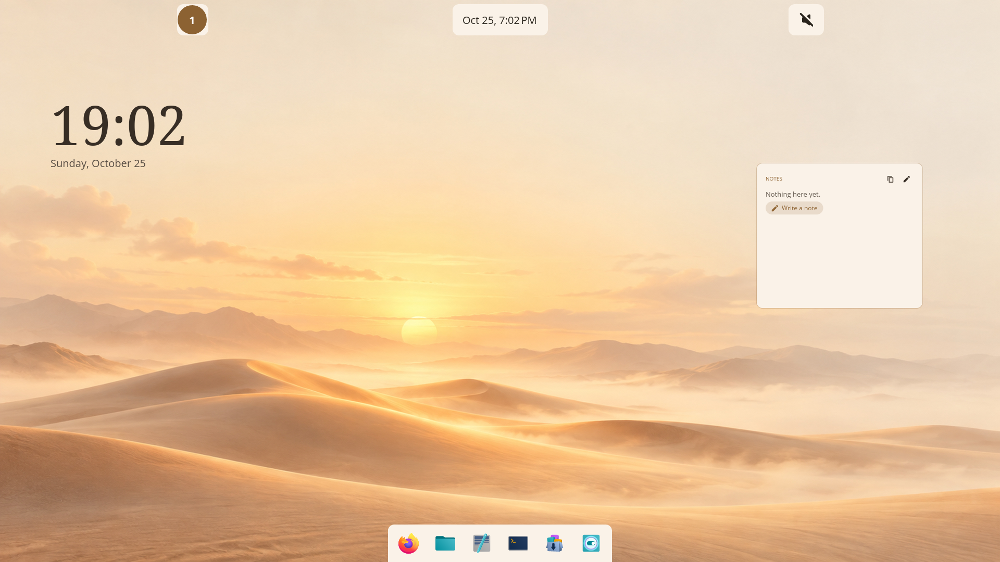
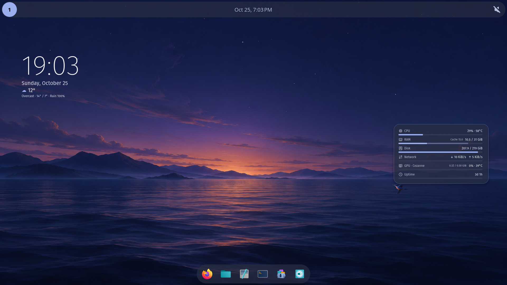
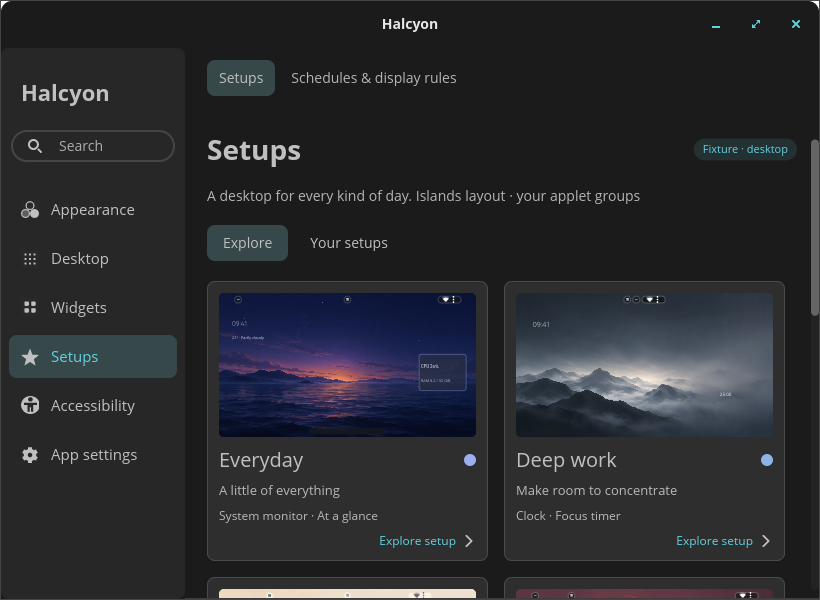
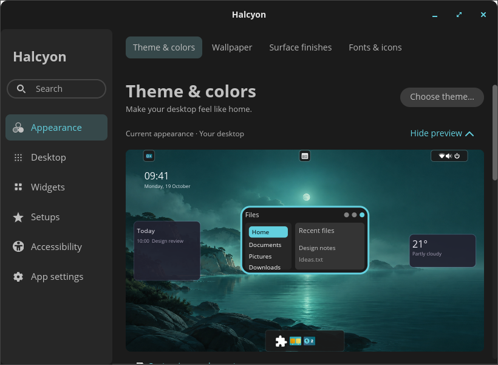
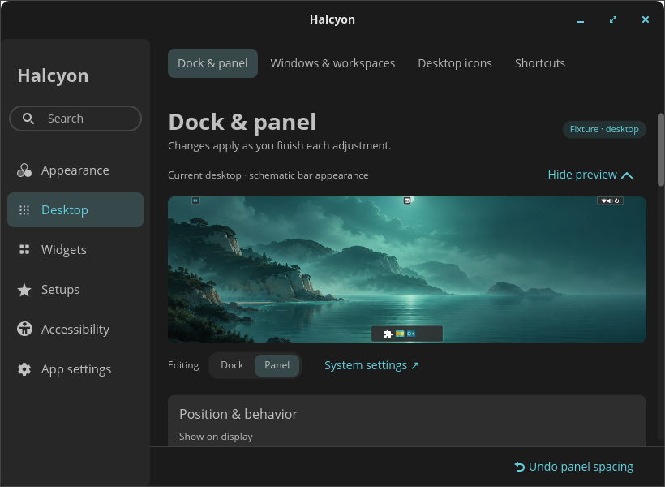
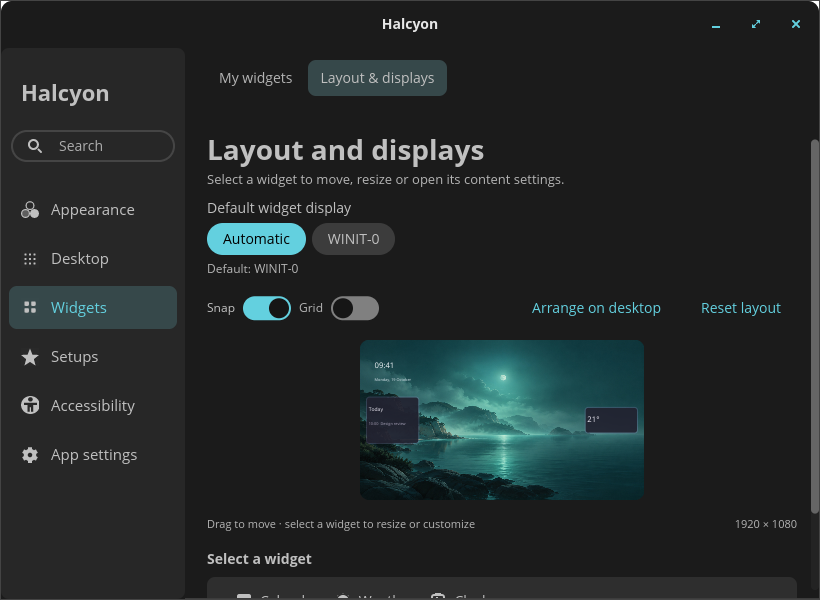
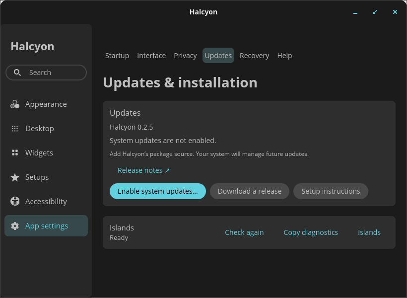
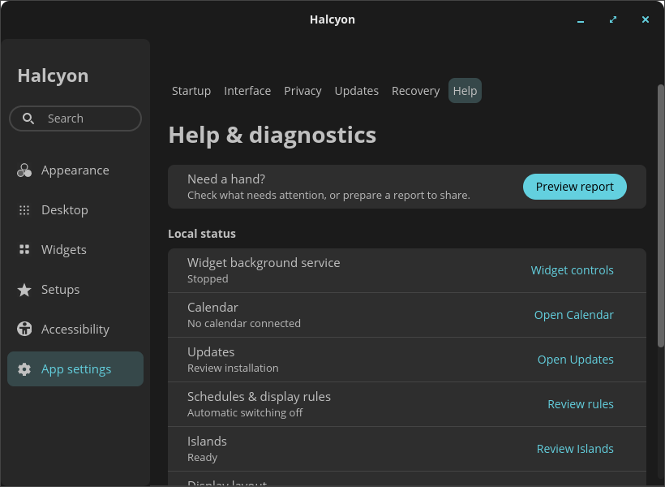
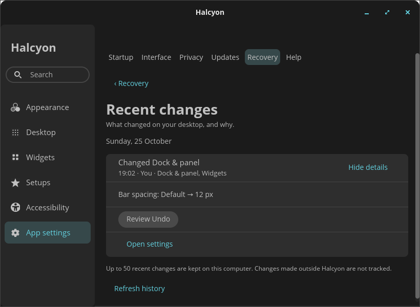

# 0.3.0 development gallery

Native captures made during 0.3.0 development, before publication. The captured
executable identified itself as 0.2.5; these images are not screenshots of the
published 0.2.5 package. **0.3.0 is now published**; its final package checks and
captures are linked from the [acceptance record](../../releases/0.3.0-acceptance.md).

## Desktop

Everyday, with the matching optional Islands companion active.

Writing desk, with a light wallpaper and separate panel groups.

The same desktop with Islands disabled. The matching companion remains loaded;
this capture does not claim a stock-panel binary was qualified.

## Settings

This 1280×900 capture is from the final 0.3.0 executable. Its private test session
uses software rendering; it is not a GPU performance measurement. The desktop
scene inside Settings is illustrative. The earlier compact captures follow.

The Updates capture shows the older/manual installation fallback. Fresh 0.3.0
packages enable the signed source during installation.

## Capture scope

Desktop images are 1920×1080 native nested-COSMIC captures with the actual widget
process, background service, settings daemon and companion. Settings images are
native 820×600 windows. Their embedded scenes are illustrative previews, not live
desktop captures. Installation/provider observations in Settings are isolated test
fixtures; the enrollment screenshot does not prove installation on this machine.
No image-generated UI or composited controls are used.

Acceptance also exercised 1280×900, light appearance and compositor-verified 150%
scale. The nested session uses software rendering and synthetic/private data.
It does not establish physical hotplug, battery life, hardware input latency,
screen-reader operation or a normal-user system authentication prompt.

Build identities, image hashes and capture provenance are in
[provenance.json](provenance.json). Raw captures and test logs remain local in
`.task-product-completion-evidence/`. Historical release images remain separate.
